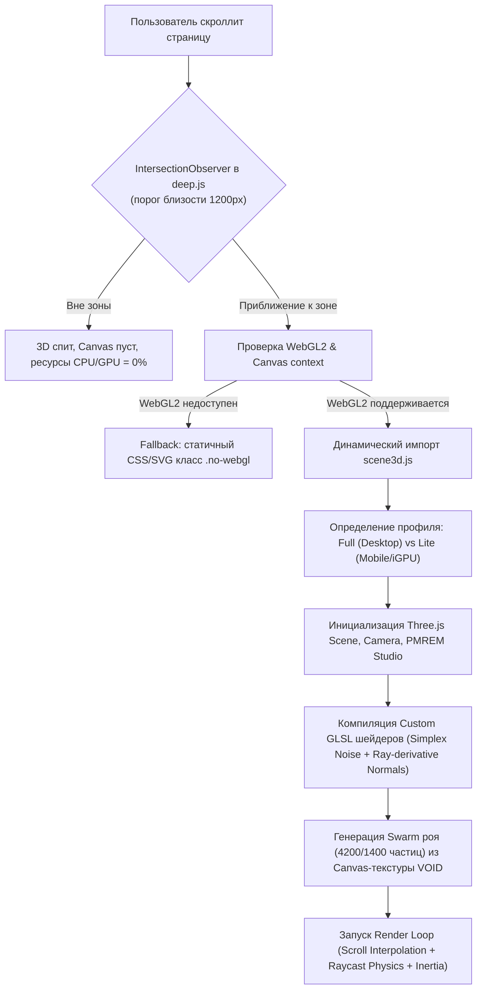
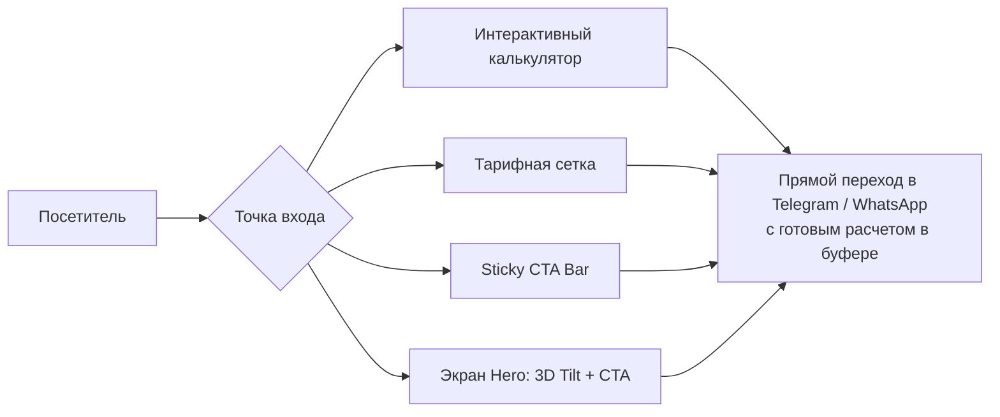

# Архитектурный паспорт и спецификация ядра проекта VOID | digital

> **Целевая аудитория документа:** Старший Архитектор / Lead AI / Engineering Team  
> **Назначение:** Полный технический срез проекта, детальный разбор интерактивного 3D-ядра, UI/UX подсистем, инфраструктуры и точек расширения для декомпозиции и постановки инженерных задач.  
> **Дата формирования:** 17 ноября 2026 г.  
> **Версия кодовой базы:** v1.12.1 (ветка `main`, синхронизирована с `origin/main`).  

---

## 1. Паспорт и бизнес-контекст проекта

* **Бренд:** `VOID | digital` — веб-студия премиальной разработки цифровых сервисов, лендингов, интернет-магазинов и интерактивных интерфейсов с высокой визуальной ценностью.
* **Юридическое лицо:** ИП Лосуков Даниил Васильевич (ИНН `244312594492`, ОГРНИП `326246800121182`).
* **Позиционирование:** High-end digital production без раздутого бюрократического штата. Акцент на чистый ванильный стек без фреймворкового оверхеда, исключительную скорость загрузки (Core Web Vitals 95+), авторский 3D WebGL-интерактив и прямое закрытие на коммуникацию в Telegram/WhatsApp.
* **Боевой контур:**
  * Production URL: [https://void-digital.ru](https://void-digital.ru) (canonical, SSL Let's Encrypt через Cloudflare).
  * Хостинг & CDN: **Cloudflare Pages** (проект `void-digital-site`, автоматический CI/CD деплой при push в `main`).
  * Репозиторий GitHub: `Popper-sys/void-digital-site` (ветка `main`).
  * DNS-провайдер: Рег.ру (делегирован на NS-серверы Cloudflare: `alla.ns.cloudflare.com`, `peter.ns.cloudflare.com`).
  * Локальный путь разработки на PC1: `C:\Users\User\Desktop\claude\site\`.

---

## 2. Архитектурная парадигма и структура кодовой базы

Проект спроектирован по парадигме **Zero-Build Vanilla Architecture**:
1. **Отсутствие тяжелых бандлеров на клиенте:** В коде отсутствуют Webpack/Vite/Rollup в production-контуре. Все скрипты подключаются как нативные ES-модули (`<script type="module">`) с использованием `importmap` для разрешения внешних библиотек.
2. **Мгновенная отдача:** Статический контент отдается напрямую с edge-нод Cloudflare (TTFB < 25–40 мс по РФ и миру).
3. **Строгая изоляция служебных файлов:** Файл `_redirects` предотвращает прямой доступ пользователей к служебным скриптам, тестам, документации и конфигурациям.

### Дерево файлов проекта

```text
site/
├── .github/                      # CI/CD пайплайны GitHub Actions
├── css/
│   └── style.css                 # Дизайн-система: CSS Variables, токены, адаптив, анимации, слои
├── fonts/                        # Локальные шрифты (Manrope woff2, preload кириллицы)
├── functions/                    # Serverless-слой (Cloudflare Pages Functions)
│   └── api/
│       └── lead.js               # POST /api/lead — классификатор заявок и шлюз в Telegram
├── img/                          # Оптимизированные ассеты (WebP, SVG, favicon)
│   └── portfolio/                # Скриншоты кейсов 660x440 webp
├── js/                           # Клиентская логика (Core Engine)
│   ├── deep.js                   # Lazy-loader и контроллер видимости 3D-зоны
│   ├── hero-fx.js                # Интерактив первого экрана (3D Tilt карточки, магнитный курсор)
│   ├── main.js                   # Основной контроллер UI (калькулятор, модальные окна, Sticky CTA)
│   └── scene3d.js                # ЯДРО: WebGL/Three.js 3D-сцена, шейдеры, физика, рой частиц
├── legacy-netlify/               # Архивные функции Netlify (на случай отката)
├── scripts/
│   └── version-assets.py         # Утилита хеширования ассетов (?v=hash) для обхода 4h кеша Cloudflare
├── tests/                        # Автоматизированное тестирование
│   ├── package.json              # Playwright dependencies
│   ├── playwright.config.js      # Конфигурация матричных тестов (Desktop Chrome, Mobile Safari)
│   └── site.spec.js              # E2E тесты рендеринга страниц, логики калькулятора и 3D
├── vendor/                       # Вендорные зависимости (Three.js r169+ standalone ES-модули)
├── 404.html                      # Страница ошибки (защита от SPA fallback в Cloudflare Pages)
├── index.html                    # Главный лендинг с интерактивной 3D-зоной
├── services.html, portfolio.html # Страницы услуг и кейсов
├── about.html, contacts.html     # Страницы студии и контактов
├── privacy.html                  # Политика обработки ПДн (152-ФЗ compliant)
├── _redirects                    # Правила маппинга и защиты служебных директорий
└── robots.txt, sitemap.xml       # SEO метаданные
```

---

## 3. Детальный разбор ядра: 3D WebGL Engine (`scene3d.js` & `deep.js`)

Ядро визуального превосходства проекта сосредоточено в модуле `js/scene3d.js` (объемом ~38 КБ чистого математического и шейдерного кода) под управлением легковесного загрузчика `js/deep.js`.



### 3.1. Умная ленивая загрузка (`deep.js`)
* **Цель:** Исключить просадку метрик Core Web Vitals (LCP, FID/INP, TBT) на первом экране.
* **Механика:** `deep.js` отслеживает появление контейнера `#deep` с запасом `rootMargin: '1200px 0px'`.
* **Hardware Detection:** Предварительно создается временный canvas с запросом контекста `webgl2`. Если контекст не поддерживается, скрипт мгновенно навешивает класс `.no-webgl` и не загружает Three.js, подставляя легковесный fallback.

### 3.2. Архитектура визуальных слоев в `scene3d.js`

1. **Procedural Studio & Reflection Environment (`makeStudio`):**
   * Вместо тяжелых HDR-панорам (10–20 МБ) генерируется процедурная виртуальная фотостудия из 6 световых панелей (софтбокс, фиолетовые и голубые стрипы, фронтальный акцент, контрастный контур).
   * Через `THREE.PMREMGenerator` сцена запекается в кубическую текстуру окружения с шероховатостью `0.02`, обеспечивая фотореалистичные цветные рефлексы на стекле при нулевом сетевом трафике.

2. **Liquid Glass Blob (Сфера из жидкого стекла):**
   * Базовая геометрия: `THREE.SphereGeometry` (384×288 полигонов в Full-режиме, 176×132 в Lite).
   * Материал: `THREE.MeshPhysicalMaterial` с кастомной шейдерной модификацией через хук `.onBeforeCompile`.
   * **Оптические параметры:** `transmission = 1.0`, `roughness = 0.035`, `ior = 1.6`, `thickness = 1.3`, `dispersion = 6.0` (хроматическое спектральное разложение света на RGB), `iridescence = 0.85` (бензиновые переливы тонких пленок), `attenuationColor = #8b7bff`.

3. **Vertex Shader & Математический аппарат шума:**
   * Интегрирован 3D Simplex Noise (Ashima Arts).
   * **Процедурная деформация:**
     $$\text{Disp}(d) = \text{Noise}_1(d \cdot f_1 + t_1) \cdot A + \text{Noise}_2(d \cdot f_2 - t_2) \cdot (A \cdot 0.16) + \text{PushCursor} + \text{Ripple}(d)$$
   * **Вихревое скручивание (`uTwist`):** Координаты $x, z$ вращаются вокруг вертикальной оси $y$ пропорционально высоте вершины:
     $$\theta = \text{uTwist} \cdot y, \quad \begin{pmatrix} x' \\ z' \end{pmatrix} = \begin{pmatrix} \cos\theta & -\sin\theta \\ \sin\theta & \cos\theta \end{pmatrix} \begin{pmatrix} x \\ z \end{pmatrix}$$
   * **Честный расчет нормалей (Analytic-like Tangent Finite Differences):** Так как шум и вихрь меняют геометрию в шейдере, исходные нормали сферы становятся невалидными. Шейдер вычисляет два соседних ортогональных вектора смещения ($\vec{P}_A$ и $\vec{P}_B$) с дельтой $0.008$ и берет их векторное произведение:
     $$\vec{N} = \text{normalize}\left( (\vec{P}_A - \vec{P}) \times (\vec{P}_B - \vec{P}) \right)$$
     Это обеспечивает идеальные блики и отражения без артефактов гранения.

4. **Интерактивная физика волны (Shockwave Ripple):**
   * При клике или тапе Raycaster определяет локальную точку пересечения со сферой ($\vec{D}_{\text{rip}}$).
   * В шейдер передаются `uRipDir` и таймер `uRipT`. Волна распространяется по угловому расстоянию:
     $$\Delta = \arccos(\vec{d} \cdot \vec{D}_{\text{rip}}) - 1.7 \cdot t$$
     $$\text{Wave} = 0.085 \cdot \sin(16\Delta) \cdot e^{-5\Delta^2} \cdot e^{-0.8t}$$

5. **Particle Swarm Core (Кинетический рой частиц):**
   * Буферная геометрия: `THREE.BufferGeometry` на 4 200 частиц (1 400 в Lite).
   * **Генерация координат:** В рантайме создается скрытый canvas 1600×640, рендерится типографика Manrope `VOID`, сканируются пиксели (`getImageData`), отбираются точки букв и преобразуются в массив целевых позиций `swTarget`.
   * **Анимация сборки:** Каждая частица имеет стартовую позицию в рассеянном сферическом облаке `swStart` и индивидуальную фазу задержки. По мере скролла к блоку `.deep-final` фактор сборки интерполируется от $0.0$ до $1.0$, частицы движутся по изогнутым дугам, собираясь в светящийся логотип за стеклом.

6. **Кинематика курсора, захват и инерция:**
   * **Raycasting:** Отслеживание наведения на сферу с изменением системного курсора (`.deep-grab`, `.deep-grabbing`).
   * **Drag & Spin with Momentum:** Мышью сферу можно схватить и раскрутить в горизонтальной плоскости. При отпускании угловая скорость затухает по закону трения:
     $$\omega_{t+1} = \omega_t \cdot 0.94$$

7. **Постобработка (Full vs Lite адаптация):**
   * **Full Profile (Десктоп с GPU):** `EffectComposer` с 16-битным буфером полуторной точности (`HalfFloatType`), 4× MSAA сглаживание, `UnrealBloomPass` (мягкий неоновый ореол бликов), `ACESFilmicToneMapping`.
   * **Lite Profile (Смартфоны, планшеты, слабые iGPU):** Отключение Bloom-прохода, прямой рендеринг в экранный буфер, обнуление дисперсии света (`dispersion = 0`), снижение плотности сеток в 2.5 раза, ограничение `devicePixelRatio` до $1.5$. Обеспечивает стабильные 60 FPS даже на мобильных устройствах.

---

## 4. UI/UX Подсистемы и логика конверсий (`main.js` & `hero-fx.js`)



1. **Hero 3D Parallax & Magnetic Cursor (`hero-fx.js`):**
   * Первый экран отслеживает вектор курсора и наклоняет макет в 3D-пространстве через матричные трансформации CSS (`perspective`, `rotateX`, `rotateY`).
   * Учитывает системный медиа-запрос `prefers-reduced-motion` для доступности (a11y).
2. **Интерактивный пошаговый калькулятор стоимости (`main.js`):**
   * 3-шаговый визард: Тип сайта (лендинг, магазин, корпоративный, визитка) $\to$ Дополнительные модули (CRM, 3D WebGL, мультиязычность, SEO) $\to$ Сроки и бюджет.
   * Динамический расчет вилки цен и сроков без перезагрузки.
   * Кнопка «Обсудить расчет» генерирует глубокую ссылку в Telegram с предзаполненным текстовым брифом.
3. **Бесшовный Native Modal (`<dialog>`):**
   * Использование нативного HTML5 элемента `<dialog>` с автоматическим управлением фокусом и доступностью.
4. **Sticky CTA Bar:**
   * Появляется при прокрутке ниже первого экрана, автоматически скрывается при попадании в зону самого калькулятора или при открытии экранной клавиатуры на смартфонах.
5. **Privacy First (152-ФЗ):**
   * На сайте отсутствуют сохраняющие серверные формы, требующие обработки ПДн третьими лицами: посетитель перенаправляется напрямую в мессенджер, передавая данные осознанно по защищенному каналу.

---

## 5. Серверный слой: Cloudflare Pages Function (`functions/api/lead.js`)

Хотя основной упор сделан на прямые переходы в Telegram, в проекте развернут серверный микросервис обработки заявок (API endpoint `/api/lead`):

```javascript
// Архитектура валидации и обогащения заявки:
1. Валидация JSON payload
2. Honeypot check: поле `website` должно быть пустым (защита от спам-ботов)
3. 152-ФЗ check: обязательное наличие флага `consent === true`
4. Семантический классификатор (Auto-Tagging):
   - Regex-поиск ключевых маркеров (shop, b2b, tender, small)
5. Отправка форматированного Markdown-уведомления в Telegram бот
```

* Переменные окружения хранятся в Cloudflare Secrets: `TELEGRAM_BOT_TOKEN`, `TELEGRAM_CHAT_ID`.
* Исходный код функций изолирован от публичного скачивания через `_redirects`.

---

## 6. Пайплайн тестирования и деплоя

1. **E2E регрессионное тестирование (`tests/site.spec.js`):**
   * Автоматический прогон через Playwright:
     * Проверка всех 10 страниц на HTTP 200, корректность `<title>`, наличие `<h1>` и отсутствие JS-ошибок в консоли.
     * Проверка корректности расчетов калькулятора (лендинг + опции = точный ценовой диапазон).
     * Проверка связки калькулятора с 3D-зоной («Добавить 3D в расчет»).
2. **Управление кешированием статики (`scripts/version-assets.py`):**
   * Cloudflare CDN жестко кеширует `.css` и `.js` файлы на 4 часа.
   * Python-скрипт перед релизом рассчитывает MD5-хеш содержимого `style.css` и `main.js` и атомарно проставляет query-параметры `?v=xxxx` во всех HTML-файлах.
3. **CI/CD:**
   * `git push origin main` $\to$ Cloudflare Pages автоматически подхватывает коммит и разворачивает Edge-релиз в течение 45–60 секунд.

---

## 7. Вектор задач и точки роста для Архитектора

Ниже приведен перечень готовых технических направлений, по которым Архитектор может ставить задачи инженерам:

### Направление A: Развитие 3D Core & WebGL эффектов
* **Задача A.1:** Реализация кастомных GLSL матроксов (MatCap) для ультра-быстрого рендера на мобильных чипсетах с сохранением бликов жидкого стекла без `PMREMGenerator`.
* **Задача A.2:** Перенос физики роя частиц (Swarm) на GPGPU (Compute shaders или Simulation pass на WebGL2 Render-to-Texture Float), что позволит увеличить количество частиц с 4 200 до 50 000+ при 60 FPS.
* **Задача A.3:** 3D-интерактивный селектор кейсов: отображение 3D-карточек работ с плавным облетом камеры при скролле.

### Направление B: Продуктовый функционал и конверсионные механики
* **Задача B.1:** Интерактивный 3D-конфигуратор сайта прямо в калькуляторе (пользователь собирает блоки сайта в 3D-кубе и видит изменение сметы в реальном времени).
* **Задача B.2:** A/B сплит-тестирование заголовков и офферов на базе Cloudflare Workers / Pages Functions (edge-side rewriting без клиентских мерцаний).
* **Задача B.3:** Telegram Mini App (TMA): упаковка сайта/калькулятора в формат Telegram Web App для открытия прямо внутри мессенджера без перехода в браузер.

### Направление C: Инфраструктура, метрики и надежность
* **Задача C.1:** Внедрение легковесного telemetry-модуля для мониторинга WebGL crashes (ловить `webglcontextlost` и отправлять в аналитику процент устройств, упавших в fallback).
* **Задача C.2:** Автоматизация запуска `scripts/version-assets.py` через Git pre-commit hook или GitHub Actions workflow, чтобы исключить человеческий фактор при правках стилей.
* **Задача C.3:** Доработка Playwright-тестов для визуального регрессионного тестирования (Visual Snapshots / Pixelmatch) 3D-сцены на опорных контрольных точках.

---

## 8. Резюме

Проект представляет собой образец высокоскоростного, чистого фронтенд-инжиниринга. В нем отсутствуют раздутые сторонние зависимости, а визуальный WOW-эффект достигается глубоким знанием WebGL, шейдеров GLSL и нативных браузерных API. Архитектура готова к масштабированию, интеграции интерактивных 3D-конфигураторов и выходу в сегмент Enterprise-разработки.
