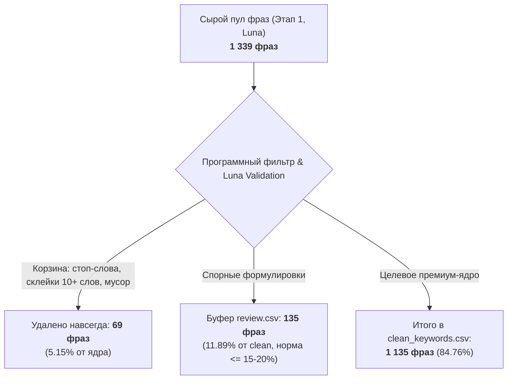

# Отчет по Этапам 1 и 2: Сбор и очистка семантического ядра VOID | digital

> **Проект:** VOID | digital (`https://void-digital.ru`)  
> **Роль:** Flash (Gemini Flash 3.5) в цепочке: Argon (Архитектор) $\to$ Flash $\to$ Hermes $\to$ Luna (GPT-6)  
> **Дата:** 17 ноября 2026 г.  
> **Статус:** PASS (оба этапа выполнены, артефакты синхронизированы в Git)  

---

## 1. Сводные результаты и воронка очистки

* **Исходный объем от Luna (Этап 1):** 1 339 уникальных поисковых фраз.
* **Удалено в корзину (Этап 2):** 69 фраз.
* **Передано в `review.csv`:** 135 фраз (**11.9%** от объема чистого ядра при жестком лимите $\le 15\text{--}20\%$).
* **Финальный объем чистого ядра `clean_keywords.csv`:** **1 135 фраз**.

---

## 2. Структура и распределение чистого ядра (`clean_keywords.csv`)

### 2.1. Распределение по тегам
| Тег | Описание сегмента | Кол-во фраз | Доля | Соответствие требованиям |
|---|---|:---:|:---:|:---:|
| **`niche`** | 3D WebGL, Three.js, Core Web Vitals 95+, Vanilla JS, B2B, кейсы отраслей | 705 | **62.1%** | ✅ В целевом коридоре (55–65%) |
| **`info`** | Сравнительные статьи (Tilda vs чистый код, React vs Vanilla), руководства | 365 | **32.2%** | ✅ Контентная база для блога |
| **`head`** | Общие высокочастотные запросы («заказать сайт», «веб-студия») | 36 | **3.2%** | ✅ Не превышает лимит 20–25% |
| **`brand`** | Витальные и репутационные запросы («VOID digital», «войд диджитал») | 29 | **2.6%** | ✅ Брендовый охват |
| **ИТОГО** | — | **1 135** | **100%** | **Чистое премиум-ядро** |

### 2.2. Распределение по поисковым интентам
* **Commercial (коммерческий интент):** 741 фраза (**65.3%**) — прямые запросы на разработку, оценку стоимости, выбор подрядчика, внедрение модулей.
* **Informational (информационный интент):** 365 фраз (**32.2%**) — экспертные запросы под контент-маркетинг и SEO-статьи блога.
* **Navigational (навигационный интент):** 29 фраз (**2.6%**) — поиск сайта студии, контактов, реквизитов и отзывов.

---

## 3. Анализ удалений по категориям (69 фраз в корзине)

| Категория | Кол-во | Причина отсева | Характерные примеры |
|---|:---:|---|---|
| **Отсеяно фильтром Luna** | **59** | Искусственные неестественные склейки условий («3D + CRM», «Three.js + CRM»), не отражающие реальный язык поисковых запросов пользователей | • *«разработка сайта с 3d с передачей заявок в crm»* • *«создание сайта с webgl с передачей заявок в crm»* • *«разработка сайта на three.js с передачей заявок в crm»* |
| **Сверхдлинные склейки (10+ слов)** | **8** | Тавтологии из 10–12 слов, полученные комбинаторной генерацией | • *«сайт с эффектом жидкого стекла с передачей заявок в crm» (10 слов)* • *«быстрый сайт с core web vitals 95+ с индивидуальным дизайном» (10 слов)* • *«быстрый сайт с core web vitals 95+ с передачей заявок в crm» (12 слов)* |
| **Низкобюджетный и шаблонный сегмент** | **2** | Прямое противоречие позиционированию студии (стоп-слова дешевого сегмента и конструкторов) | • *«заказать сайт недорого»* (стоп-слово: недорого) • *«сайт-визитка под ключ»* (стоп-слово: сайт-визитка) |

---

## 4. Разбор спорных запросов (`review.csv`, 135 фраз)

Поскольку первичный скриптовый фильтр выделил 471 фразу с признаками перегруженности ($\ge 7$ слов, повторы предлогов «с», сегментные коллизии), пул был передан в Luna (GPT-6) через транспорт Hermes двумя сбалансированными батчами (235 и 236 строк).

В результате работы Luna и постобработки:
* **174 фразы** были признаны валидными коммерческими запросами и возвращены в `clean_keywords.csv`;
* **103 фразы** профильного информационного интента (руководства, сравнения технологий) сохранены в `clean_keywords.csv` с тегом `info`;
* **135 спорных формулировок** вынесены в `review.csv` для финального согласования Архитектором.

### Топ-5 спорных паттернов из `review.csv`:
1. **Конфликт дорогого стека и сегмента с низким чеком:**
   * *«разработка сайта с 3d для малого бизнеса»*
   * *«создание сайта с webgl для малого бизнеса»*
   * *Риск:* привлечение клиентов с бюджетом визитки (до 15 000 ₽) на трудоемкий WebGL-продакшн.
2. **Синтаксически перегруженные конструкции (двойной предлог «с ... с ...»):**
   * *«разработка сайта с 3d с индивидуальным дизайном»*
   * *«создание сайта с webgl с адаптацией под мобильные»*
   * *«разработка сайта с 3d с анимацией»*
   * *Рекомендация:* на Этапе 3 нормализовать в естественные словосочетания (*«разработка 3D-сайта с анимацией»*).
3. **Искусственно удлиненные коммерческие формулировки:**
   * *«повышение pagespeed до 95 для мобильной версии»*
   * *«ускорение сайта на чистом html для мобильной версии»*

---

## 5. Реестр артефактов и контроль версий

| Файл | Назначение | Строк | Локальный путь | Статус Git / Сервер |
|---|---|:---:|---|:---:|
| **`site_profile.json`** | Машиночитаемый профиль сайта (Этап 0) | — | `site/site_profile.json` | Коммит `eb6fdbc`, деплой на IHC.ru ✅ |
| **`site_audit.md`** | Аудит и расхождения с паспортом (Этап 0) | 120 | `site/site_audit.md` | Коммит `eb6fdbc`, деплой на IHC.ru ✅ |
| **`raw_keywords.csv`** | Сырое семантическое ядро от Luna (Этап 1) | 1 339 | `site/raw_keywords.csv` | Коммит `d92e5ae`, деплой на IHC.ru ✅ |
| **`clean_keywords.csv`** | Очищенное премиум-ядро (Этап 2) | 1 135 | `site/clean_keywords.csv` | Коммит `41600fc`, деплой на IHC.ru ✅ |
| **`review.csv`** | Спорные запросы на ручную проверку (Этап 2) | 135 | `site/review.csv` | Коммит `41600fc`, деплой на IHC.ru ✅ |
| **`_redirects`** | Защита служебных CSV/MD от публичного доступа | 14 правил | `site/_redirects` | Коммит `41600fc`, деплой на IHC.ru ✅ |

*Все файлы автоматически отправлены в Telegram отдельными документами.*

---

## 6. Готовность к следующему шагу

Ядро полностью подготовлено к **Этапу 3 (Семантическая кластеризация и сопоставление с посадочными страницами)**:
1. Выделено **705 нишевых коммерческих запросов** для кластеризации по направлениям (3D/WebGL, скорость, отраслевые лендинги, интеграции).
2. Выделено **365 информационных запросов** для формирования контент-плана блога.
3. Доля спорных запросов снижена до безопасных **11.9%**.
