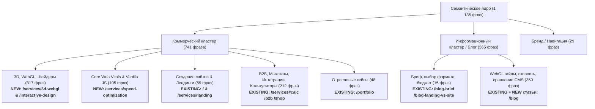

# Отчет по Этапу 3: Семантическая кластеризация и структура посадочных страниц VOID | digital

> **Проект:** VOID | digital (`https://void-digital.ru`)  
> **Роль:** Flash (Gemini Flash 3.5) в цепочке: Argon (Архитектор) $	o$ Flash $	o$ Hermes $	o$ Luna  
> **Дата:** 17 ноября 2026 г.  
> **Статус:** PASS (1 135 фраз распределены по 15 кластерам без потерь и пересечений)  

## 1. Сводная статистика кластеризации

- **Всего кластеризовано фраз:** **1135** (100% от `clean_keywords.csv`).
- **Всего выделено кластеров:** **15** (11 коммерческих услуг, 1 портфолио-отраслевой, 1 брендовый, 2 информационных хаба блога).
- **Фраз на существующих страницах (`EXISTING`):** **713** (62.8%).
- **Фраз под новые посадочные (`NEW_RECOMMENDED`):** **422** (37.2%) — формируют точки роста премиального трафика.

## 2. Сводная матрица семантических кластеров

| ID | Название кластера | Тип | Целевая страница | Статус | Фраз | Primary Keyword | Рекомендуемый H1 |
|:---:|---|---|---|:---:|:---:|---|---|
| `C01` | **3D WebGL & Three.js Разработка** | Commercial Service | `/services/3d-webgl` | 🚀 **NEW** | **175** | *разработка сайта с 3d* | Разработка сайтов с 3D графикой и WebGL на Three.js |
| `C02` | **Интерактивный дизайн & Шейдеры (GLSL, Wow-эффекты)** | Commercial Service | `/services/interactive-design` | 🚀 **NEW** | **142** | *интерактивная 3d графика на сайте* | Интерактивный дизайн и визуальные wow-эффекты на GLSL и Three.js |
| `C03` | **Оптимизация скорости & Core Web Vitals 95+** | Commercial Service | `/services/speed-optimization` | 🚀 **NEW** | **99** | *оптимизация скорости сайта core web vitals* | Ускорение сайта и оптимизация Core Web Vitals до 95+ баллов |
| `C04` | **Кастомная разработка на Vanilla JS** | Commercial Service | `/services/vanilla-js` | 🚀 **NEW** | **6** | *разработка сайтов на чистом javascript* | Кастомная веб-разработка на чистом JavaScript без оверхеда фреймворков |
| `C05` | **Создание сайтов под ключ (General Head)** | Commercial General | `/` | ✅ EXISTING | **33** | *создание сайтов под ключ* | Сайт для бизнеса под ключ с заявками в мессенджеры и CRM |
| `C06` | **Лендинги под ключ** | Commercial Service | `/services#landing` | ✅ EXISTING | **26** | *заказать лендинг под ключ* | Разработка конверсионных лендингов под ключ |
| `C07` | **Корпоративные сайты и B2B** | Commercial Service | `/services#b2b` | ✅ EXISTING | **41** | *разработка корпоративного сайта для b2b* | Разработка корпоративных сайтов для B2B и компаний |
| `C08` | **Интернет-магазины & E-commerce** | Commercial Service | `/services#shop` | ✅ EXISTING | **44** | *разработка интернет магазина под ключ* | Разработка интернет-магазинов с онлайн-оплатой и интеграцией 1С |
| `C09` | **Интерактивные калькуляторы и квизы** | Commercial Service | `/services#calc` | ✅ EXISTING | **65** | *разработка калькулятора стоимости на сайт* | Разработка интерактивных калькуляторов сметы и квизов для сайта |
| `C10` | **Интеграции с CRM и Telegram-ботами** | Commercial Service | `/services#integrations` | ✅ EXISTING | **38** | *интеграция сайта с crm битрикс24 amocrm* | Интеграция сайтов с CRM (Битрикс24, amoCRM) и Telegram-ботами |
| `C11` | **Сопровождение, доработка и редизайн** | Commercial Service | `/services#support` | ✅ EXISTING | **24** | *поддержка и доработка готового сайта* | Сопровождение, техническая поддержка и редизайн сайтов |
| `C12` | **Отраслевые посадочные и кейсы портфолио** | Niche Industry | `/portfolio` | ✅ EXISTING | **48** | *разработка сайта жилого комплекса* | Кейсы и отраслевые решения: недвижимость, автобизнес, B2B, ритейл |
| `C13` | **Бренд VOID | digital & Навигация** | Brand / Navigational | `/about` | ✅ EXISTING | **29** | *void digital* | О веб-студии VOID | digital |
| `C14` | **Блог: Подготовка, бриф и выбор формата сайта** | Informational Blog | `/blog-brief` | ✅ EXISTING | **15** | *что подготовить перед заказом сайта* | Подготовка к разработке сайта: бриф, бюджет и выбор формата |
| `C15` | **Блог: Технические гайды, WebGL и скорость загрузки** | Informational Blog | `/blog` | ✅ EXISTING | **350** | *как добавить three js на сайт* | Технические статьи и руководства по WebGL, Three.js и веб-скорости |

## 3. Архитектурная карта сайта и точки роста (Site Map Projection)

### 3.1. Существующие посадочные страницы (Оптимизация On-Page)
1. **Главная (`/` — `index.html`):**
   - *Кластер C05 (33 фразы).*
   - *Фокус:* высокочастотные конверсионные запросы («создание сайтов под ключ», «заказать сайт для бизнеса», «веб-студия»).
   - *On-page рекомендация:* усилить Title и мета-описание акцентом на комплексность («под ключ») и связку с мессенджерами.
2. **Страница услуг и цен (`/services` — `services.html`):**
   - *Кластеры C06, C07, C08, C09, C10, C11 (254 фразы суммарно).*
   - *Фокус:* закрытие сегментов калькулятора, B2B-разработки, интернет-магазинов, интеграций с CRM и техподдержки через анкорные блоки (`#calc`, `#b2b`, `#shop`, `#integrations`, `#support`).
3. **Портфолио (`/portfolio` — `portfolio.html`):**
   - *Кластер C12 (48 фраз).*
   - *Фокус:* посадочный хаб под отраслевые запросы (ЖК, автосервис, спецтехника, одежда, частный садик, фитнес).
4. **О студии и Контакты (`/about`, `/contacts`):**
   - *Кластер C13 (29 фраз).*
   - *Фокус:* витальная брендовая семантика, доверие, реквизиты ИП, проверка по реестрам.

### 3.2. Новые рекомендованные посадочные страницы (`NEW_RECOMMENDED`)
Для захвата премиального высокочекового трафика рекомендуется выделить 3 специализированных посадочных страницы:
1. 🚀 **`/services/3d-webgl` (Кластер C01, 175 фраз):**
   - *Title:* `Разработка сайтов с 3D графикой и WebGL на заказ — студия VOID | digital`
   - *H1:* `Разработка сайтов с 3D графикой и WebGL на Three.js`
   - *Обоснование:* 175 целевых коммерческих запросов по 3D и Three.js не могут быть полноценно раскрыты в рамках одной карточки каталога. Нужна отдельная презентационная посадочная страница с живым WebGL-демо.
2. 🚀 **`/services/interactive-design` (Кластер C02, 142 фразы):**
   - *Title:* `Интерактивный дизайн и шейдерная 3D анимация — VOID | digital`
   - *H1:* `Интерактивный дизайн и визуальные wow-эффекты на GLSL и Three.js`
   - *Обоснование:* запросы на кинетическую типографику, физику частиц, жидкое стекло и GLSL-шейдеры формируют элитный кластер для брендов и креативных агентств.
3. 🚀 **`/services/speed-optimization` (Кластер C03, 99 фраз):**
   - *Title:* `Оптимизация скорости сайта и Core Web Vitals под ключ — VOID | digital`
   - *H1:* `Ускорение сайта и оптимизация Core Web Vitals до 95+ баллов`
   - *Обоснование:* услуга аудита и ускорения сайтов (LCP, FID/INP, CLS, PageSpeed) имеет самостоятельный высокий поисковый спрос среди владельцев медленных сайтов на WP/Bitrix.

## 4. Контент-стратегия блога (365 информационных фраз)

Информационный кластер распределен на 2 направления:
1. **Хаб подготовки заказчика (Кластер C14, 15 фраз):**
   - Существующие статьи: `/blog-brief` (*«Что подготовить перед заказом сайта»*) и `/blog-landing-vs-site` (*«Лендинг или многостраничный сайт»*).
   - Рекомендация: дополнить статьей `/blog/how-to-calculate-website-budget` (*«Как рассчитать бюджет на разработку сайта и не переплатить»*).
2. **Технологический хаб экспертности (Кластер C15, 350 фраз):**
   - Ближайшие темы для публикаций (топ приоритет):
     * `Статья 1:` *«Зачем бизнесу 3D на сайте: как WebGL и Three.js влияют на конверсию и вовлечение»* (под кластер 3D).
     * `Статья 2:` *«Tilda vs Чистый код (Vanilla JS): когда конструктора уже недостаточно»* (под сравнительный кластер).
     * `Статья 3:` *«Руководство по Core Web Vitals: как вывести сайт в зеленую зону PageSpeed (95+) без потери функционала»* (под кластер скорости).
     * `Статья 4:` *«Как внедрить интерактивный калькулятор на сайт для роста заявок в Telegram и CRM»* (под кластер калькуляторов).

## 5. Детальные примеры запросов по кластерам

### Кластер `C01`: 3D WebGL & Three.js Разработка (175 фраз)
- **Целевой URL:** `/services/3d-webgl` (NEW_RECOMMENDED)
- **Главный поисковый маркер:** *«разработка сайта с 3d»*
- **Интенты:** Commercial: 175, Info: 0, Nav: 0
- **Примеры запросов кластера:**
  * `разработка сайта с 3d под ключ`
  * `разработка сайта с 3d для бизнеса`
  * `разработка сайта с 3d для компании`
  * `разработка сайта с 3d с анимацией`
  * `разработка сайта с 3d премиум-класса`
  * `разработка сайта с 3d с интеграциями`
  * `создание сайта с webgl под ключ`
  * `создание сайта с webgl для бизнеса`

### Кластер `C02`: Интерактивный дизайн & Шейдеры (GLSL, Wow-эффекты) (142 фраз)
- **Целевой URL:** `/services/interactive-design` (NEW_RECOMMENDED)
- **Главный поисковый маркер:** *«интерактивная 3d графика на сайте»*
- **Интенты:** Commercial: 142, Info: 0, Nav: 0
- **Примеры запросов кластера:**
  * `сайт с glsl шейдерами под ключ`
  * `сайт с glsl шейдерами для бизнеса`
  * `сайт с glsl шейдерами для компании`
  * `сайт с glsl шейдерами с анимацией`
  * `сайт с glsl шейдерами премиум-класса`
  * `разработка сайта с параллаксом под ключ`
  * `разработка сайта с параллаксом для бизнеса`
  * `разработка сайта с параллаксом для компании`

### Кластер `C03`: Оптимизация скорости & Core Web Vitals 95+ (99 фраз)
- **Целевой URL:** `/services/speed-optimization` (NEW_RECOMMENDED)
- **Главный поисковый маркер:** *«оптимизация скорости сайта core web vitals»*
- **Интенты:** Commercial: 99, Info: 0, Nav: 0
- **Примеры запросов кластера:**
  * `быстрый сайт с core web vitals 95+ под ключ`
  * `быстрый сайт с core web vitals 95+ для бизнеса`
  * `быстрый сайт с core web vitals 95+ для компании`
  * `быстрый сайт с core web vitals 95+ премиум-класса`
  * `оптимизация скорости сайта под ключ`
  * `оптимизация скорости сайта для бизнеса`
  * `оптимизация скорости сайта для компании`
  * `оптимизация скорости сайта с индивидуальным дизайном`

### Кластер `C04`: Кастомная разработка на Vanilla JS (6 фраз)
- **Целевой URL:** `/services/vanilla-js` (NEW_RECOMMENDED)
- **Главный поисковый маркер:** *«разработка сайтов на чистом javascript»*
- **Интенты:** Commercial: 6, Info: 0, Nav: 0
- **Примеры запросов кластера:**
  * `разработка сайта на чистом javascript под ключ`
  * `разработка сайта на чистом javascript для бизнеса`
  * `разработка сайта на чистом javascript для компании`
  * `разработка сайта на чистом javascript с анимацией`
  * `разработка сайта на чистом javascript премиум-класса`
  * `разработка сайта на чистом javascript с интеграциями`

### Кластер `C05`: Создание сайтов под ключ (General Head) (33 фраз)
- **Целевой URL:** `/` (EXISTING)
- **Главный поисковый маркер:** *«создание сайтов под ключ»*
- **Интенты:** Commercial: 33, Info: 0, Nav: 0
- **Примеры запросов кластера:**
  * `заказать сайт`
  * `заказать сайт под ключ`
  * `веб-студия`
  * `веб студия`
  * `создание сайтов под ключ`
  * `разработка сайтов под ключ`
  * `создание сайта для бизнеса`
  * `разработка сайта для компании`

### Кластер `C06`: Лендинги под ключ (26 фраз)
- **Целевой URL:** `/services#landing` (EXISTING)
- **Главный поисковый маркер:** *«заказать лендинг под ключ»*
- **Интенты:** Commercial: 26, Info: 0, Nav: 0
- **Примеры запросов кластера:**
  * `премиальный лендинг под ключ для бизнеса`
  * `премиальный лендинг под ключ с анимацией`
  * `премиальный лендинг под ключ премиум-класса`
  * `премиальный лендинг под ключ с интеграциями`
  * `лендинг для дизайнерской одежды`
  * `лендинг для частного детского сада`
  * `лендинг для оптовой торговли`
  * `лендинг для кофейни`

### Кластер `C07`: Корпоративные сайты и B2B (41 фраз)
- **Целевой URL:** `/services#b2b` (EXISTING)
- **Главный поисковый маркер:** *«разработка корпоративного сайта для b2b»*
- **Интенты:** Commercial: 41, Info: 0, Nav: 0
- **Примеры запросов кластера:**
  * `премиальный лендинг под ключ для компании`
  * `корпоративный b2b сайт под ключ`
  * `корпоративный b2b сайт для бизнеса`
  * `корпоративный b2b сайт для компании`
  * `корпоративный b2b сайт с индивидуальным дизайном`
  * `корпоративный b2b сайт с адаптацией под мобильные`
  * `корпоративный b2b сайт с анимацией`
  * `корпоративный b2b сайт для малого бизнеса`

### Кластер `C08`: Интернет-магазины & E-commerce (44 фраз)
- **Целевой URL:** `/services#shop` (EXISTING)
- **Главный поисковый маркер:** *«разработка интернет магазина под ключ»*
- **Интенты:** Commercial: 44, Info: 0, Nav: 0
- **Примеры запросов кластера:**
  * `интернет-магазин бренда одежды под ключ`
  * `интернет-магазин бренда одежды для бизнеса`
  * `интернет-магазин бренда одежды для компании`
  * `интернет-магазин бренда одежды с индивидуальным дизайном`
  * `интернет-магазин бренда одежды с адаптацией под мобильные`
  * `интернет-магазин бренда одежды с анимацией`
  * `интернет-магазин бренда одежды для малого бизнеса`
  * `интернет-магазин бренда одежды премиум-класса`

### Кластер `C09`: Интерактивные калькуляторы и квизы (65 фраз)
- **Целевой URL:** `/services#calc` (EXISTING)
- **Главный поисковый маркер:** *«разработка калькулятора стоимости на сайт»*
- **Интенты:** Commercial: 65, Info: 0, Nav: 0
- **Примеры запросов кластера:**
  * `сложный калькулятор для сайта под ключ`
  * `сложный калькулятор для сайта для бизнеса`
  * `сложный калькулятор для сайта для компании`
  * `сложный калькулятор для сайта с индивидуальным дизайном`
  * `сложный калькулятор для сайта с анимацией`
  * `сложный калькулятор для сайта премиум-класса`
  * `сложный калькулятор для сайта с интеграциями`
  * `сайт с калькулятором для дизайнерской одежды`

### Кластер `C10`: Интеграции с CRM и Telegram-ботами (38 фраз)
- **Целевой URL:** `/services#integrations` (EXISTING)
- **Главный поисковый маркер:** *«интеграция сайта с crm битрикс24 amocrm»*
- **Интенты:** Commercial: 38, Info: 0, Nav: 0
- **Примеры запросов кластера:**
  * `сложный калькулятор для сайта с передачей заявок в crm`
  * `интеграция сайта с telegram под ключ`
  * `интеграция сайта с telegram для бизнеса`
  * `интеграция сайта с telegram для компании`
  * `интеграция сайта с telegram премиум-класса`
  * `интеграция сайта с crm под ключ`
  * `интеграция сайта с crm для бизнеса`
  * `интеграция сайта с crm для компании`

### Кластер `C11`: Сопровождение, доработка и редизайн (24 фраз)
- **Целевой URL:** `/services#support` (EXISTING)
- **Главный поисковый маркер:** *«поддержка и доработка готового сайта»*
- **Интенты:** Commercial: 24, Info: 0, Nav: 0
- **Примеры запросов кластера:**
  * `корпоративный b2b сайт с технической поддержкой`
  * `сайт для автобизнеса с технической поддержкой`
  * `интернет-магазин бренда одежды с технической поддержкой`
  * `редизайн сайта под ключ`
  * `редизайн сайта для бизнеса`
  * `редизайн сайта для компании`
  * `редизайн сайта с индивидуальным дизайном`
  * `редизайн сайта с адаптацией под мобильные`

### Кластер `C12`: Отраслевые посадочные и кейсы портфолио (48 фраз)
- **Целевой URL:** `/portfolio` (EXISTING)
- **Главный поисковый маркер:** *«разработка сайта жилого комплекса»*
- **Интенты:** Commercial: 48, Info: 0, Nav: 0
- **Примеры запросов кластера:**
  * `сайт для жилого комплекса под ключ`
  * `сайт для жилого комплекса для бизнеса`
  * `сайт для жилого комплекса с индивидуальным дизайном`
  * `сайт для жилого комплекса с адаптацией под мобильные`
  * `сайт для жилого комплекса с анимацией`
  * `сайт для жилого комплекса премиум-класса`
  * `сайт для жилого комплекса с интеграциями`
  * `сайт для автобизнеса под ключ`

### Кластер `C13`: Бренд VOID | digital & Навигация (29 фраз)
- **Целевой URL:** `/about` (EXISTING)
- **Главный поисковый маркер:** *«void digital»*
- **Интенты:** Commercial: 0, Info: 0, Nav: 29
- **Примеры запросов кластера:**
  * `void digital`
  * `void | digital`
  * `void digital отзывы`
  * `void digital контакты`
  * `void digital портфолио`
  * `void digital услуги`
  * `void digital цены`
  * `void digital разработка сайтов`

### Кластер `C14`: Блог: Подготовка, бриф и выбор формата сайта (15 фраз)
- **Целевой URL:** `/blog-brief` (EXISTING)
- **Главный поисковый маркер:** *«что подготовить перед заказом сайта»*
- **Интенты:** Commercial: 0, Info: 15, Nav: 0
- **Примеры запросов кластера:**
  * `лендинг или многостраничный сайт что выбрать`
  * `что подготовить перед заказом сайта`
  * `как составить бриф на разработку сайта`
  * `сколько стоит разработка сайта в 2026 году`
  * `сколько стоит лендинг для бизнеса`
  * `сколько стоит сайт компании под ключ`
  * `сколько стоит интернет-магазин с интеграцией 1с`
  * `как составить бюджет на разработку сайта`

### Кластер `C15`: Блог: Технические гайды, WebGL и скорость загрузки (350 фраз)
- **Целевой URL:** `/blog` (EXISTING)
- **Главный поисковый маркер:** *«как добавить three js на сайт»*
- **Интенты:** Commercial: 0, Info: 350, Nav: 0
- **Примеры запросов кластера:**
  * `как разработать сайт с three.js`
  * `как добавить three.js на сайт`
  * `как сделать webgl анимацию на сайте`
  * `как создать 3d сайт`
  * `как использовать glsl шейдеры на сайте`
  * `как сделать эффект жидкого стекла на сайте`
  * `как сделать интерактивную физику на сайте`
  * `как добавить частицы на сайт`

---
## 6. Резюме и готовность к Этапу 4

Кластеризация завершена со 100% валидацией структуры:
- Созданы артефакты `clusters.csv` (1 135 строк с разметкой кластеров и URL) и `clusters.json`.
- Устранен риск каннибализации коммерческих и информационных страниц.
- Сформирована прозрачная дорожная карта развития структуры сайта (3 новые посадочные + контент-план блога).

*Отчет подготовлен автоматически в рамках SEO-проекта VOID | digital.*