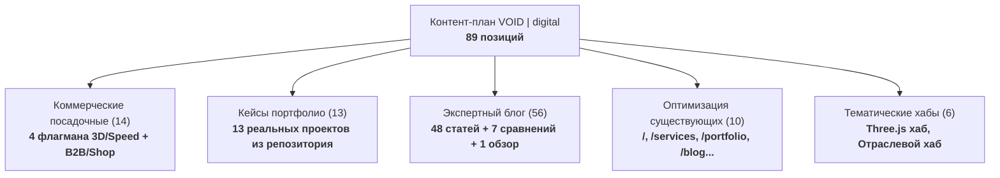

# Архитектурный отчет по Этапу 4: Проектирование контент-плана VOID | digital

> **Проект:** VOID | digital (`https://void-digital.ru`)  
> **Роль:** Flash (Gemini Flash 3.5) в цепочке: Argon (Архитектор) $	o$ Flash $	o$ Hermes $	o$ Luna (GPT-6)  
> **Дата:** 17 ноября 2026 г.  
> **Статус:** PASS (сформирован `content_plan.csv` на 89 позиций с глубокой декомпозицией всех кластеров)  

## 1. Сводные метрики контент-плана

- **Всего спроектировано контентных единиц:** **89 позиций** (при норме 50–75+).
- **Новые материалы (`NEW`):** **77 позиций** (13 кейсов, 10 коммерческих посадочных, 48 статей, 6 хабов).
- **Оптимизация существующих страниц (`OPTIMIZE EXISTING`):** **10 страниц** (все 10 физических HTML-файлов сайта).
- **Слияние и защита от каннибализации (`MERGE`):** **2 позиции** (брендовый хаб и дубликаты прейскуранта).

### Распределение по типам и этапам воронки
| Параметр | Категория | Кол-во | Доля | Назначение в стратегии |
|---|---|:---:|:---:|---|
| **Тип контента** | Статья | 48 | 53.9% | Раскрытие инфо-кластеров C14/C15, how-to, разборы |
| | Лендинг | 14 | 15.7% | Прямая генерация лидов на услуги |
| | Кейс | 13 | 14.6% | Социальное доказательство по 13 отраслям |
| | Сравнение | 7 | 7.9% | Высококонверсионный инфо-трафик (Tilda vs Vanilla, React vs Vanilla) |
| | Хаб | 6 | 6.7% | Разводящие страницы и внутренняя перелинковка |
| | Обзор | 1 | 1.1% | Технический обзор инструментария |
| **Роль в воронке** | Привлечение | 37 | 41.6% | Верх воронки (ToFu): поисковый трафик по технологиям и скорости |
| | Конверсия | 26 | 29.2% | Низ воронки (BoFu): посадочные услуг и детальные кейсы |
| | Прогрев | 21 | 23.6% | Середина воронки (MoFu): сравнения, бриф, выбор подрядчика |
| | Brand-defense | 5 | 5.6% | Защита репутации и официальные страницы |
| **Приоритет** | P1 (Top) | 52 | 58.4% | Первоочередное внедрение (флагманы, кейсы, базовые сравнения) |
| | P2 (Medium) | 34 | 38.2% | Масштабирование контента второй очереди |
| | P3 (Low) | 3 | 3.4% | Узкоспециализированные темы |

## 2. Реестр 13 отраслевых кейсов портфолио (`NEW /portfolio/<slug>`)

Каждый проект из `site_audit.md` развернут в самостоятельную посадочную страницу формата `кейс`:

| ID | Отрасль / Проект | Изображение | Целевой URL | Приоритет | Ключевые запросы |
|:---:|---|---|---|:---:|---|
| `001` | **Кейс: интернет-магазин дизайнерской одежды OMG** | `интернет-магазин дизайнерской одежды OMG` | `/portfolio/omg` | `P1` | *разработка интернет-магазина одежды; сайт бренда одежды; интернет-магазин дизайнерской одежды* |
| `002` | **Кейс: сайт частного детского сада «Солнечные дети»** | `сайт частного детского сада «Солнечные дети»` | `/portfolio/solnechnye-deti` | `P1` | *сайт частного детского сада; сайт для детского сада; разработка сайта для детского образования* |
| `003` | **Кейс: сайт поставщика банных веников оптом** | `сайт поставщика банных веников оптом` | `/portfolio/veniki` | `P1` | *сайт оптового поставщика; сайт для оптовых поставок; сайт для продажи банных веников оптом* |
| `004` | **Кейс: сайт кофейни NØR** | `сайт кофейни NØR` | `/portfolio/nor` | `P2` | *сайт кофейни; сайт для кафе; разработка сайта для HoReCa* |
| `005` | **Кейс: сайт природного камня для ландшафта** | `сайт природного камня для ландшафта` | `/portfolio/prirodny-kamen` | `P2` | *сайт природного камня; сайт для ландшафтного дизайна; сайт стройматериалов* |
| `006` | **Кейс: сайт жилого комплекса «Соцветие»** | `сайт жилого комплекса «Соцветие»` | `/portfolio/sotsvetie` | `P1` | *разработка сайта жилого комплекса; сайт застройщика; сайт новостройки* |
| `007` | **Кейс: сайт ремонта и обслуживания спецтехники** | `сайт ремонта и обслуживания спецтехники` | `/portfolio/spectech` | `P2` | *сайт ремонта спецтехники; сайт обслуживания спецтехники; B2B сайт сервисной компании* |
| `008` | **Кейс: личный сайт предпринимателя и спикера** | `личный сайт предпринимателя и спикера` | `/portfolio/expert` | `P2` | *сайт предпринимателя; сайт спикера; сайт личного бренда* |
| `009` | **Кейс: сайт фитнес-клуба «СТАЛЬ»** | `сайт фитнес-клуба «СТАЛЬ»` | `/portfolio/stal` | `P2` | *сайт фитнес-клуба; сайт спортивного клуба; разработка сайта для фитнеса* |
| `010` | **Кейс: сайт автосервиса по ремонту BMW** | `сайт автосервиса по ремонту BMW` | `/portfolio/bmw-service` | `P1` | *сайт автосервиса BMW; сайт ремонта BMW; сайт премиального автосервиса* |
| `011` | **Кейс: сайт импорта автомобилей из Японии, Китая и Кореи** | `сайт импорта автомобилей из Японии, Китая и Кореи` | `/portfolio/autoconsult` | `P1` | *сайт импорта автомобилей; сайт авто под заказ из Японии; сайт импорта авто из Китая и Кореи* |
| `012` | **Кейс: сайт студии маникюра** | `сайт студии маникюра` | `/portfolio/manicure` | `P2` | *сайт студии маникюра; сайт салона красоты; сайт для бьюти-сферы* |
| `013` | **Кейс: сайт ремонта квартир под ключ** | `сайт ремонта квартир под ключ` | `/portfolio/remont` | `P1` | *сайт ремонта квартир под ключ; сайт ремонтной компании; сайт премиального ремонта* |

## 3. Реестр 10 коммерческих посадочных страниц услуг (`NEW /services/<slug>`)

Покрывают высокочековые и нишевые кластеры C01, C02, C03, C04 и специализированные модули:

| ID | Услуга / Направление | Кластер | Целевой URL | Роль | Тезисный план |
|:---:|---|:---:|---|:---:|---|
| `014` | **Флагманская услуга: разработка 3D-сайтов и WebGL** | `C01` | `/services/3d-webgl` | `конверсия` | Создать коммерческую страницу с задачами для бизнеса, этапами, технологическим стеком, производитель... |
| `015` | **Флагманская услуга: интерактивный дизайн и GLSL-шейдеры** | `C02` | `/services/interactive-design` | `конверсия` | Объяснить, когда интерактивная 3D-графика оправдана, как проектируются эффекты и как обеспечиваются ... |
| `016` | **Флагманская услуга: оптимизация скорости и Core Web Vitals** | `C03` | `/services/speed-optimization` | `конверсия` | Описать диагностику, приоритизацию LCP INP CLS и план оптимизации без обещания фиксированного балла ... |
| `017` | **Флагманская услуга: сайты на чистом JavaScript** | `C04` | `/services/vanilla-js` | `конверсия` | Показать применение Vanilla JS, архитектуру без лишнего рантайма, этапы разработки, границы подхода ... |
| `018` | **Услуга: лендинги под ключ** | `C06` | `/services/landing-pages` | `конверсия` | Раскрыть стратегию одностраничного сайта, структуру блоков, дизайн, адаптивность, аналитику и интегр... |
| `019` | **Услуга: корпоративные сайты для B2B** | `C07` | `/services/corporate-sites` | `конверсия` | Показать структуру корпоративного сайта, страницы услуг и отраслей, работу с доверием и сбором лидов... |
| `020` | **Услуга: интернет-магазины и e-commerce** | `C08` | `/services/ecommerce` | `конверсия` | Описать каталог, фильтры, карточку товара, корзину, оплату, доставку, интеграции и мобильный UX; ком... |
| `021` | **Услуга: калькуляторы стоимости и квизы** | `C09` | `/services/calculators` | `конверсия` | Показать типы калькуляторов, логику ветвления, расчёт, валидацию, аналитику и передачу лида; привест... |
| `022` | **Услуга: интеграции сайта с CRM и Telegram** | `C10` | `/services/integrations` | `конверсия` | Описать карту данных и событий, передачу заявок, уведомления, обработку ошибок и тестирование интегр... |
| `023` | **Услуга: поддержка, доработка и редизайн сайтов** | `C11` | `/services/support-redesign` | `конверсия` | Разделить поддержку действующего сайта, развитие функциональности и редизайн; описать аудит, оценку ... |

## 4. План перепозиционирования существующих страниц (`OPTIMIZE EXISTING`)

Все 10 существующих HTML-файлов из паспорта проекта получили детальный план доработки без создания дублей:

| URL страницы | Действие | Текущее состояние | План оптимизации и перехода к High-End |
|---|:---:|---|---|
| `/services` | `OPTIMIZE EXISTING` | Зафиксировано в `site_audit.md` | **Хаб услуг: создание сайта под ключ:** Собрать обзор форматов и услуг с маршрутизацией на подходящие коммерческие посадочные; развести общие запросы создания сайтов и специализированные услуги, чтобы не конкурировать с ними. |
| `/` | `OPTIMIZE EXISTING` | Зафиксировано в `site_audit.md` | **Главная: позиционирование и навигация:** Усилить уникальное позиционирование студии, кратко обозначить специализацию, реальные кейсы и путь к контакту; общие коммерческие запросы направлять на /services. |
| `/portfolio` | `OPTIMIZE EXISTING` | Зафиксировано в `site_audit.md` | **Портфолио: структура каталога и кейсов:** Сделать каталог 13 проектов с фильтрацией по типу бизнеса и ссылками на отдельные кейсы; добавить контекст задачи и решений, не выдумывать метрики. |
| `/about` | `OPTIMIZE EXISTING` | Зафиксировано в `site_audit.md` | **О студии: команда, подход и доверие:** Раскрыть специализацию, процесс, принципы работы и подтверждаемую экспертизу; связать заявления с портфолио, не публиковать неподтверждённые награды и отзывы. |
| `/contacts` | `OPTIMIZE EXISTING` | Зафиксировано в `site_audit.md` | **Контакты и брендовая навигация:** Упростить путь к связи, указать актуальные каналы и ожидания по следующему шагу; сверить контактные данные и разметку организации. |
| `/blog` | `OPTIMIZE EXISTING` | Зафиксировано в `site_audit.md` | **Блог: тематические хабы и внутренняя перелинковка:** Сгруппировать публикации по выбору сайта, стоимости, технологиям, WebGL и скорости; связать статьи с релевантными услугами и кейсами без переспама. |
| `/blog-brief` | `OPTIMIZE EXISTING` | Зафиксировано в `site_audit.md` | **Что подготовить перед заказом сайта:** Обновить существующую статью: добавить чек-лист материалов, доступов, контента и ответственных, пример брифа и ссылки на этапы разработки. |
| `/blog-landing-vs-site` | `OPTIMIZE EXISTING` | Зафиксировано в `site_audit.md` | **Лендинг или многостраничный сайт: как выбрать:** Обновить существующую статью: сравнить задачи, структуру, контент и сценарии роста; дать дерево выбора и не дублировать общую страницу создания сайтов. |
| `/privacy` | `OPTIMIZE EXISTING` | Зафиксировано в `site_audit.md` | **Политика конфиденциальности и доверие:** Проверить актуальность текста, доступность и соответствие фактическим способам обработки данных; не использовать страницу как коммерческую посадочную. |
| `/404.html` | `OPTIMIZE EXISTING` | Зафиксировано в `site_audit.md` | **Страница 404 и возврат к ключевым разделам:** Проверить статус ответа и полезность страницы: понятное сообщение, переходы на услуги, портфолио и контакты; сохранить корректную индексацию ошибки. |

## 5. Декомпозиция инфо-кластеров блога (C14 и C15 — 56 экспертных публикаций)

Мега-кластер C15 (350 запросов) и C14 (15 запросов) декомпозированы на **56 уникальных статей, сравнений и хабов**:

### 5.1. Топ-10 флагманских статей по 3D, WebGL и Three.js
- **`/blog/create-3d-website-threejs`** (статья, `P1`): **Как создать 3D-сайт на Three.js: архитектура проекта**  
  *Тезисы:* Показать путь от прототипа сцены к интеграции в интерфейс: структура модулей, ассеты, состояние загрузки, адаптивность и план деградации.  
  *Запросы:* `как создать 3d сайт; как разработать сайт с three.js; создать 3D сайт на Three.js`
- **`/blog/webgl-animation-guide`** (статья, `P1`): **Как сделать WebGL-анимацию на сайте**  
  *Тезисы:* Разобрать render loop, временную шкалу, взаимодействие со скроллом и синхронизацию с интерфейсом; отдельно показать, когда достаточно CSS-анимации.  
  *Запросы:* `как сделать webgl анимацию на сайте; WebGL анимация на сайте; интерактивная анимация WebGL`
- **`/blog/threejs-scene-camera-light`** (статья, `P2`): **Three.js: сцена, камера и освещение без лишних затрат**  
  *Тезисы:* Объяснить базовые компоненты сцены и способы контролировать количество источников света и сложность материалов; пример должен быть воспроизводимым.  
  *Запросы:* `Three.js сцена камера свет; освещение в Three.js; оптимизация 3D сцены`
- **`/blog/glsl-shaders-on-website`** (статья, `P1`): **Как использовать GLSL-шейдеры на сайте**  
  *Тезисы:* Показать минимальную связку shader material и uniforms, передачу времени и координат; обозначить требования к WebGL и путь без шейдеров.  
  *Запросы:* `как использовать glsl шейдеры на сайте; GLSL шейдеры сайт; shader material Three.js`
- **`/blog/glsl-fragment-shader-web`** (статья, `P2`): **Фрагментный шейдер GLSL: первый эффект для веба**  
  *Тезисы:* Пошагово разобрать фрагментный шейдер, координаты UV и цветовой вывод; дать безопасный простой пример и объяснить отличия устройств и GPU.  
  *Запросы:* `GLSL fragment shader пример; фрагментный шейдер для сайта; GLSL для WebGL`
- **`/blog/threejs-particle-physics`** (статья, `P1`): **Физика частиц в Three.js: интерактивная система**  
  *Тезисы:* Рассмотреть атрибуты геометрии, обновление позиции, шум и ограничения количества частиц; сравнить GPU- и CPU-подходы на уровне выбора решения.  
  *Запросы:* `физика частиц Three.js; частицы на сайте WebGL; интерактивные частицы Three.js`
- **`/blog/optimize-threejs-draw-calls`** (статья, `P1`): **Оптимизация Three.js: draw calls, геометрия и материалы**  
  *Тезисы:* Дать аудитный чек-лист по количеству draw calls, повторному использованию геометрии и материалов, batching и видимости объектов; измерять до и после на целевых устройствах.  
  *Запросы:* `оптимизация Three.js; уменьшить draw calls Three.js; производительность 3D сайта`
- **`/blog/optimize-webgl-gpu`** (статья, `P1`): **Оптимизация WebGL: GPU, fill rate и overdraw**  
  *Тезисы:* Объяснить, как разрешение canvas, прозрачность, полноэкранные эффекты и сложность фрагментного шейдера влияют на GPU; предложить порядок профилирования.  
  *Запросы:* `оптимизация WebGL; WebGL производительность сайта; GPU нагрузка WebGL`
- **`/blog/mobile-3d-fallback`** (статья, `P1`): **3D-сайт на мобильных: адаптация и graceful fallback**  
  *Тезисы:* Описать проверку производительности на слабых устройствах, снижение DPR, упрощение сцены, отключение тяжёлых эффектов и доступный статичный fallback.  
  *Запросы:* `3D сайт мобильная версия; мобильный fallback WebGL; оптимизация Three.js для смартфонов`
- **`/blog/load-gltf-glb-threejs`** (статья, `P2`): **Как загружать 3D-модели GLTF/GLB на сайт**  
  *Тезисы:* Разобрать экспорт моделей, текстуры, сжатие, загрузчик и прогрессивное отображение; подчеркнуть, что размер результата проверяется на реальном наборе ассетов.  
  *Запросы:* `загрузить GLTF на сайт; GLB Three.js; оптимизация 3D модели для сайта`

### 5.2. Топ-10 статей по скорости Core Web Vitals и Vanilla JS
- **`/blog/webgl-core-web-vitals`** (статья, `P1`): **WebGL и Core Web Vitals: как не ухудшить скорость**  
  *Тезисы:* Связать запуск 3D-графики с LCP и отзывчивостью страницы; предложить измерение до и после, отложенный запуск и приоритет критического контента.  
  *Запросы:* `WebGL Core Web Vitals; Three.js LCP; скорость 3D сайта`
- **`/blog/threejs-postprocessing-performance`** (статья, `P2`): **Постобработка в Three.js: когда она нужна и как удешевить**  
  *Тезисы:* Сравнить эффекты постобработки с базовыми материалами, описать разрешение буферов, число проходов и отключение второстепенных эффектов.  
  *Запросы:* `Three.js postprocessing; постобработка WebGL; оптимизация эффектов Three.js`
- **`/blog/core-web-vitals-95-guide`** (статья, `P1`): **Core Web Vitals 95+: план измерения и оптимизации**  
  *Тезисы:* Разобрать различие лабораторных и полевых данных, повторяемый аудит и последовательность улучшений; балл 95+ подать как цель, а не гарантию.  
  *Запросы:* `оптимизация скорости сайта core web vitals; Core Web Vitals 95+; быстрый сайт под ключ`
- **`/blog/improve-lcp`** (статья, `P1`): **LCP: как ускорить отрисовку главного контента**  
  *Тезисы:* Показать диагностику LCP-элемента, критического ресурса, изображений и блокирующих загрузок; связать изменения с повторными измерениями.  
  *Запросы:* `как улучшить LCP; LCP оптимизация сайта; ускорить загрузку главного контента`
- **`/blog/pagespeed-without-design-loss`** (статья, `P1`): **PageSpeed Insights: как ускорить сайт без потери дизайна**  
  *Тезисы:* Показать аудит рекомендаций, приоритизацию по эффекту и проверку визуальной целостности; объяснить, почему не каждое предупреждение требует одинакового решения.  
  *Запросы:* `PageSpeed оптимизация без потери дизайна; ускорить сайт PageSpeed; улучшить скорость сайта`
- **`/blog/zero-build-vanilla-js`** (статья, `P1`): **Zero-Build Vanilla JS: сайт без сборщика и фреймворка**  
  *Тезисы:* Объяснить архитектуру небольшого сайта без build step, модульные скрипты и ограничения; привести критерии, когда стек подходит, а когда нет.  
  *Запросы:* `Zero-Build Vanilla JS; сайт без сборщика; разработка сайтов на чистом JavaScript`
- **`/blog/react-next-vs-vanilla-js`** (сравнение, `P1`): **React/Next.js или Vanilla JS: выбор стека для сайта**  
  *Тезисы:* Сравнить требования к интерактивности, размеру проекта, команде, рендерингу и поддержке; избегать универсального утверждения о превосходстве одного стека.  
  *Запросы:* `React или Vanilla JS; Next.js или чистый JavaScript; сайт без фреймворка`

### 5.3. Высококонверсионные сравнения платформ и подходов
- **`/blog-landing-vs-site`** (`P1`): **Лендинг или многостраничный сайт: как выбрать**  
  *Тезисы:* Обновить существующую статью: сравнить задачи, структуру, контент и сценарии роста; дать дерево выбора и не дублировать общую страницу создания сайтов.  
  *Запросы:* `лендинг или многостраничный сайт что выбрать; лендинг или сайт для бизнеса; какой сайт нужен компании`
- **`/blog/css-animation-vs-webgl`** (`P2`): **Как выбрать между CSS-анимацией и WebGL**  
  *Тезисы:* Сопоставить визуальные задачи, интерактивность, стоимость поддержки и производительность; дать критерии, когда 3D не требуется.  
  *Запросы:* `CSS или WebGL анимация; когда использовать Three.js; WebGL против CSS`
- **`/blog/react-next-vs-vanilla-js`** (`P1`): **React/Next.js или Vanilla JS: выбор стека для сайта**  
  *Тезисы:* Сравнить требования к интерактивности, размеру проекта, команде, рендерингу и поддержке; избегать универсального утверждения о превосходстве одного стека.  
  *Запросы:* `React или Vanilla JS; Next.js или чистый JavaScript; сайт без фреймворка`
- **`/blog/tilda-wordpress-bitrix-vs-custom`** (`P1`): **Tilda, WordPress, Bitrix или кастомная разработка**  
  *Тезисы:* Сравнить платформы по скорости запуска, гибкости, владению контентом, поддержке и интеграциям; дать сценарии выбора без искусственного очернения платформ.  
  *Запросы:* `Tilda или кастомный сайт; WordPress или разработка с нуля; Bitrix или кастомный сайт`
- **`/blog/template-vs-custom-design`** (`P2`): **Шаблон или индивидуальный дизайн: что выбрать бизнесу**  
  *Тезисы:* Сопоставить сроки, стоимость владения, уникальность бренда и ограничения шаблона; связать критерии с типом проекта и бюджетом.  
  *Запросы:* `шаблон или индивидуальный дизайн сайта; индивидуальный сайт для бизнеса; заказать сайт с уникальным дизайном`
- **`/blog/quiz-vs-calculator`** (`P2`): **Квиз или калькулятор: какой интерактив выбрать**  
  *Тезисы:* Сравнить квиз с квалификацией лида и калькулятор с расчётом результата; дать критерии выбора по доступности исходных данных и цели бизнеса.  
  *Запросы:* `квиз или калькулятор для сайта; интерактивный квиз для бизнеса; калькулятор стоимости сайта`
- **`/blog/threejs-vs-pure-webgl`** (`P2`): **Three.js или чистый WebGL: сравнение подходов**  
  *Тезисы:* Сравнить уровень абстракции, скорость прототипирования, контроль над рендерингом и стоимость поддержки; выбрать инструмент по требованиям проекта.  
  *Запросы:* `Three.js или WebGL; чистый WebGL разработка; библиотека Three.js для сайта`

## 6. Защита от внутренней каннибализации (`MERGE` и иерархия)

Для исключения конкуренции страниц между собой внедрены правила:
1. **Брендовые запросы (`C13`):** сведены к главной `/` и разделу `/about` со статусом `MERGE`, исключая дублирующие витальные лендинги.
2. **Тарифы и калькулятор:** базовые цены на главной и детальные таблицы в `/services` синхронизируются через единый источник правды в `js/main.js`.
3. **Бриф и выбор формата (`/blog-brief`, `/blog-landing-vs-site`):** существующие тонкие статьи (~200 слов) углубляются на месте (`OPTIMIZE EXISTING`), а дополнительные прикладные чек-листы линкуются на них как расширения.

---
## 7. Резюме и статус артефактов

- Создан и валидирован файл `content_plan.csv` (89 строк).
- Полностью закрыты все 15 кластеров семантического ядра.
- Проект готов к этапу технического внедрения и написания контента.